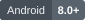
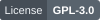

  
  <h1>Slate</h1>
  
<strong>Storage management, file exploration and device diagnostics for Android.</strong>

  

    
    
     
    
    
    
  

  
<a href="#explore-slate">Features</a> · <a href="#installation">Downloads</a> · <a href="#made-for-your-android">Privacy</a> · <a href="README.pt-BR.md">Português</a>

Slate combines storage analysis, file management, app tools and hardware diagnostics in a single customizable Material 3 interface.

## Explore Slate

<table>
  <tr>
    <td align="center" valign="middle"></td>
    <td valign="middle"><strong>Storage & cleanup</strong> Analyze space, duplicates, cache and scan history.</td>
  </tr>
  <tr>
    <td align="center" valign="middle"></td>
    <td valign="middle"><strong>File manager</strong> Tabs, previews, batch actions, ZIP extraction and built-in viewers.</td>
  </tr>
  <tr>
    <td align="center" valign="middle"></td>
    <td valign="middle"><strong>Device information</strong> CPU, GPU, RAM, battery, display and sensors.</td>
  </tr>
  <tr>
    <td align="center" valign="middle"></td>
    <td valign="middle"><strong>Performance monitor</strong> Customizable FPS, CPU, GPU and memory overlay.</td>
  </tr>
  <tr>
    <td align="center" valign="middle"></td>
    <td valign="middle"><strong>App manager</strong> Inspect installed apps, storage and cache.</td>
  </tr>
  <tr>
    <td align="center" valign="middle"></td>
    <td valign="middle"><strong>APK tools</strong> Inspect packages, verify certificates and sign APKs.</td>
  </tr>
</table>

## Made for your Android

- **Customizable interface:** Material 3, light, dark and AMOLED themes, dynamic colors and an offline gallery.
- **Privacy:** storage scans and device information are processed locally.
- **Optional advanced access:** Root and Shizuku integration for supported operations.

## Supported languages

English · Português (Brasil) · Español · Français · Italiano · Русский

Choose a language in Slate settings or follow the system default.

## Built-in tools

ZIP, JAR and CBZ editing, APK inspection and metadata editing, manifest viewer, text editing and additional archive extraction including 7Z, TZST, XZ and supported RAR versions. Includes read-only Documents Provider injection for external app files in authorized APKs. All in a single APK.

## Installation

Download [`Slate.apk`](https://github.com/stevenmx2/Slate/releases/latest) and open the file on Android. Root and Shizuku are not required for basic features.

---

  <a href="CHANGELOG.md">Changelog</a> · <a href="docs/BUILD.md">Build from source</a> · <a href="ROADMAP.md">Roadmap</a> · <a href="CREDITS.md">Credits</a> · <a href="LICENSE">License</a>

