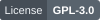

  
  <h1>Slate</h1>
  
<strong>Seu Android, sob controle.</strong>

  
Gerenciamento de armazenamento, arquivos e ferramentas de dispositivo em um aplicativo de código aberto.

  

    
    
    
  

  
Android 8.0+ · Material 3 · <a href="README.md">English README</a>

## Explore o Slate

<table>
  <tr>
    <td align="center" valign="middle"></td>
    <td valign="middle"><strong>Armazenamento e limpeza</strong> Analise espaço, duplicatas, cache e histórico.</td>
  </tr>
  <tr>
    <td align="center" valign="middle"></td>
    <td valign="middle"><strong>Gerenciador de arquivos</strong> Abas, miniaturas, operações em lote, extração ZIP e visualizadores.</td>
  </tr>
  <tr>
    <td align="center" valign="middle"></td>
    <td valign="middle"><strong>Informações do dispositivo</strong> CPU, GPU, RAM, bateria, tela e sensores.</td>
  </tr>
  <tr>
    <td align="center" valign="middle"></td>
    <td valign="middle"><strong>Monitor de desempenho</strong> Sobreposição personalizável de FPS, CPU, GPU e memória.</td>
  </tr>
  <tr>
    <td align="center" valign="middle"></td>
    <td valign="middle"><strong>Gerenciador de apps</strong> Consulte apps instalados, armazenamento e cache.</td>
  </tr>
  <tr>
    <td align="center" valign="middle"></td>
    <td valign="middle"><strong>Ferramentas de APK</strong> Inspecione pacotes, verifique certificados e assine APKs.</td>
  </tr>
</table>

## Feito para seu Android

- **Interface personalizável:** Material 3, temas claro, escuro e AMOLED, cores dinâmicas e galeria offline.
- **Privacidade:** análises de armazenamento e informações do dispositivo processadas localmente.
- **Acesso avançado opcional:** integração com Root e Shizuku para funções compatíveis.

## Idiomas disponíveis

English · Português (Brasil) · Español · Français · Italiano · Русский

O idioma pode ser alterado nas configurações do Slate ou seguir o sistema.

## Complementos

**Slate Advanced** — complemento opcional para formatos compactados adicionais, visualização de manifesto, edição de informações de APK e inspeção hexadecimal.

Quando disponível, instale `Slate-Advanced.apk` nas [GitHub Releases](https://github.com/stevenmx2/Slate/releases). Os visualizadores básicos já estão incluídos no Slate.

## Instalação

Baixe [`Slate.apk`](https://github.com/stevenmx2/Slate/releases/latest) e abra o arquivo no Android. Root e Shizuku não são necessários para as funções básicas.

---

  <a href="CHANGELOG.md">Changelog</a> · <a href="docs/BUILD.md">Compilação</a> · <a href="ROADMAP.md">Roadmap</a> · <a href="CREDITS.md">Créditos</a> · <a href="LICENSE">License</a>

